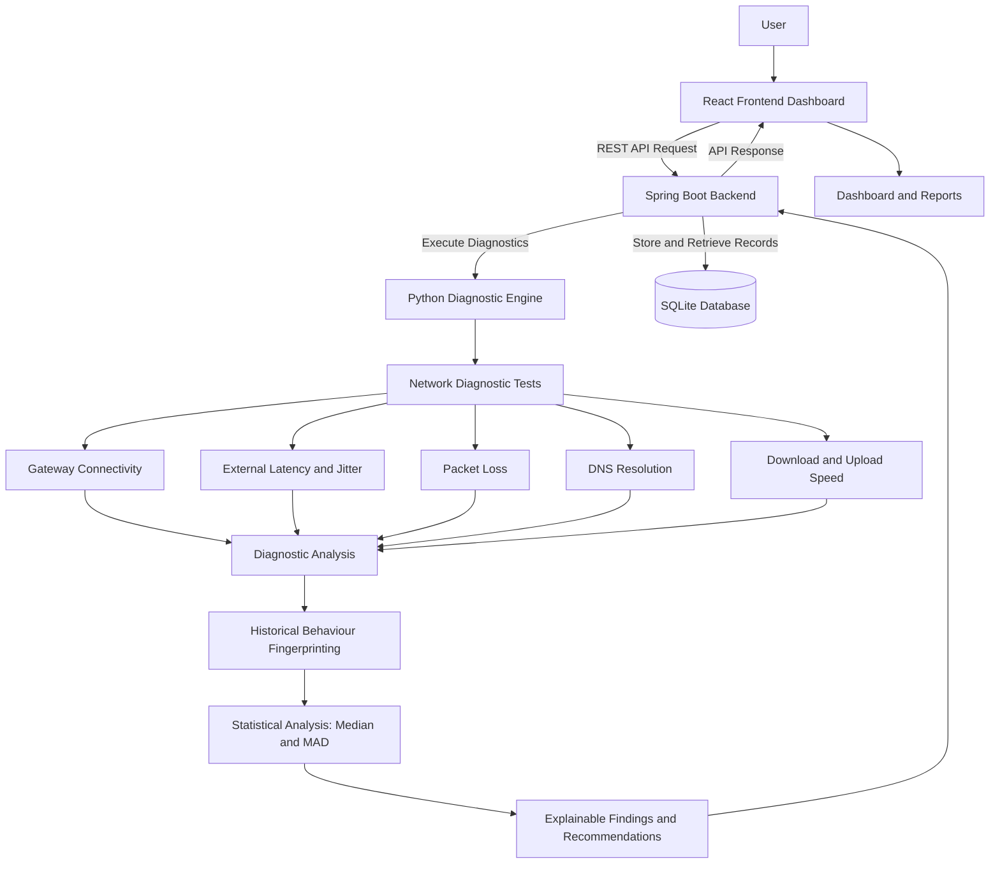

# AIORI-3-HACKATHON-PROJECTS
This repository will contain the code and resources for the AIORI-3 hackathon that will be developed during the AIORI-3
## Project Information

- **Project Name:** NetSense AI
- **Problem Statement:** PS-015
- **Team Name:** RAGNAROK
- **Team Code:** A3-PS015-TC567
- **Developed By:** Shreem Samriya
- **Team Member:** Umaima Darugar
# NetSense AI
### An Explainable Intelligent System for Home and Last-Mile Internet Connectivity Diagnosis


*
---

## 1. Project Overview

NetSense AI is an intelligent network diagnostic and analysis platform designed to help users understand, diagnose and troubleshoot home and last-mile internet connectivity problems.

Traditional internet troubleshooting tools generally display individual measurements such as download speed, upload speed and ping. However, these measurements do not always explain why an internet connection is performing poorly.

NetSense AI addresses this limitation by combining multiple network diagnostic tests with historical network behaviour analysis and explainable recommendations.

The platform collects network performance measurements, analyses them, identifies unusual behaviour when sufficient historical data is available, and presents understandable diagnostic findings through an interactive dashboard.

**Our objective is to make network troubleshooting more understandable, evidence-based and accessible to ordinary internet users.**

---

## 2. Problem Statement

Internet connectivity problems are common in homes and small networks.

Users frequently experience:
- Slow internet speeds.
- High latency and delayed responses.
- Network instability and jitter.
- Packet loss.
- DNS resolution delays.
- Inconsistent connectivity.

Most conventional diagnostic tools provide technical measurements without explaining their combined meaning.

For example, a speed test may show good download speed even when users experience gaming lag, video-call interruptions or unstable connectivity.

There is a need for a system that can:

1. Perform multiple network diagnostic tests.
2. Analyse network performance indicators together.
3. Learn normal network behaviour over time.
4. Identify deviations from historical behaviour.
5. Explain diagnostic observations.
6. Provide actionable recommendations.

NetSense AI aims to address these requirements through an integrated diagnostic platform.

---

## 3. Proposed Solution

NetSense AI combines real-time network diagnostics with statistical network behaviour fingerprinting.

The system follows a structured process:

1. Collect network performance measurements.
2. Execute connectivity and performance tests.
3. Process diagnostic results through the backend.
4. Analyse measurements and historical network behaviour.
5. Identify unusual patterns when sufficient baseline data exists.
6. Generate explainable findings and recommendations.
7. Display results through an interactive dashboard.
8. Maintain historical diagnostic records.

The platform is designed to help users understand not just what their network measurements are, but also what those measurements may indicate.

---

## 4. Key Features

### A. Comprehensive Network Diagnostics

NetSense AI performs multiple diagnostic checks, including:

- Gateway connectivity and latency.
- External connectivity and latency.
- Network jitter measurement.
- Packet loss analysis.
- DNS resolution time.
- Download speed measurement.
- Upload speed measurement.

### B. Network Behaviour Fingerprinting

The system uses historical diagnostic measurements to establish a reference profile of normal network behaviour.

This helps identify deviations that may not be obvious from a single diagnostic test.

### C. Statistical Anomaly Detection

The platform uses statistical techniques such as:

- Median-based baseline calculation.
- Median Absolute Deviation (MAD).
- Historical measurement comparison.
- Deviation-based anomaly identification.

The baseline requires a minimum of five historical samples before it becomes ready.

### D. Explainable Diagnosis

Instead of presenting only raw measurements, NetSense AI provides understandable diagnostic observations.

The system aims to explain:
- What was measured.
- What appears unusual.
- Which indicators support a finding.
- What the user can investigate next.

### E. Intelligent Recommendations

Based on available diagnostic evidence, the platform presents practical recommendations to help users investigate potential connectivity problems.

### F. Dashboard and Reports

The interactive dashboard provides access to:

- Overview.
- Live Diagnostics.
- Connection Analysis.
- Explainable Diagnosis.
- Recommendations.
- Reports and History.

---

## 5. System Architecture

NetSense AI follows a modular architecture consisting of a frontend, backend, diagnostic engine and database.



### Architecture Components

| Component | Responsibility |
|---|---|
| React + Vite | User interface and interactive dashboard |
| Java + Spring Boot | Backend services and API communication |
| Python | Network diagnostic execution and analysis |
| SQLite | Historical diagnostic data storage |
| REST API | Communication between frontend and backend |
| Ookla Speedtest CLI | Internet speed measurement |

---

## 6. Technology Stack

### Frontend
- React
- Vite
- JavaScript
- HTML
- CSS

### Backend
- Java 21
- Spring Boot
- REST API

### Diagnostic Engine
- Python 3.13
- Network diagnostic utilities
- Statistical analysis

### Database
- SQLite

### Development Tools
- Visual Studio Code
- Git
- GitHub
- GitHub Desktop
- Node.js and npm
- Maven

---

## 7. Project Workflow

The diagnostic workflow consists of the following stages:

**Stage 1: Diagnostic Initiation**

The user initiates a diagnostic test through the dashboard.

**Stage 2: Measurement Collection**

The diagnostic engine collects network performance measurements.

**Stage 3: Backend Processing**

The Spring Boot backend coordinates diagnostic execution and processes the returned results.

**Stage 4: Behaviour Analysis**

Available measurements are compared with historical network behaviour.

**Stage 5: Explainable Findings**

The system generates findings based on available diagnostic evidence.

**Stage 6: Recommendations**

The platform presents recommendations to help users investigate potential problems.

**Stage 7: Dashboard Presentation**

The results are displayed through the dashboard and can be accessed alongside historical diagnostic records.

---

## 8. Statistical Methodology

One of the important components of NetSense AI is historical network behaviour analysis.

### Median

The median represents the middle value of a dataset after arranging measurements in ascending order.

It is used to establish a baseline that is less sensitive to extreme measurements than the mean.

### Median Absolute Deviation (MAD)

MAD measures the median absolute difference between individual observations and the dataset median.

Formula:

MAD = Median(|Xi - Median(X)|)

Where:
- Xi represents an individual measurement.
- Median(X) represents the median of all measurements.

### Why Median and MAD?

Network measurements can fluctuate because of temporary congestion, background traffic and changing network conditions.

Median and MAD provide robust statistical measures for identifying unusual deviations.

### Baseline Learning

The system requires at least five historical samples before the baseline is considered ready.

Until sufficient samples are collected, the system remains in its learning phase.

**Important:** An unusual measurement is not automatically proof of a network fault. Findings should be interpreted using the available evidence and historical context.

---

## 9. Explainability and Confidence Assessment

NetSense AI aims to make its diagnostic results understandable to users.

Its confidence assessment considers factors such as:

- Diagnostic evidence coverage.
- Availability of measurements.
- Historical baseline readiness.

The confidence score represents the availability and readiness of diagnostic evidence. It should not be interpreted as a statistically validated probability that a diagnosis is correct.

The platform distinguishes between:
- A normal measurement.
- An unusual measurement.
- A potential network issue.
- A confirmed fault.

A confirmed fault requires appropriate supporting evidence.

---

## 10. Project Structure

The repository is organised into the following modules:

```text
A3-PS015-TC567/
│
├── backend/
│   └── Spring Boot backend services
│
├── database/
│   └── Database-related resources
│
├── diagnostic-agent/
│   └── Diagnostic agent resources
│
├── documentation/
│   └── Project documentation
│
├── frontend/
│   └── React + Vite dashboard
│
├── network_engine/
│   └── Python network diagnostic engine
│
├── presentation/
│   └── Project presentation resources
│
├── testing/
│   └── Testing resources
│
├── src/
│   └── Original hackathon template resources
│
├── Proposed-structure-hackathon.pdf
│
├── README.md
│
└── .gitignore
```

---

## 11. Installation and Setup

The following instructions describe the development environment.

### Prerequisites

Install the following:

- Java Development Kit 21.
- Python 3.13.
- Node.js and npm.
- Git.
- Maven (the project includes a Maven wrapper).

### Step 1: Clone the Repository

```bash
git clone https://github.com/shreemsamriya-debug/A3-PS015-TC567.git
```

Navigate into the project:

```bash
cd A3-PS015-TC567
```

### Step 2: Start the Frontend

```bash
cd frontend
npm install
npm run dev
```

Open the local development URL displayed in the terminal, usually:

```text
http://localhost:5173/
```

### Step 3: Start the Backend

Open another terminal:

```bash
cd backend
mvnw.cmd spring-boot:run
```

The backend is configured to run on port 8080 in the development environment.

### Step 4: Configure the Python Diagnostic Engine

Ensure Python is installed and accessible.

The backend must be configured with the correct Python executable and diagnostic engine directory for the local machine.

If the project uses machine-specific absolute paths, update those paths before running it on another computer.

Install the Python dependencies specified by the diagnostic engine's dependency file, if present.

### Step 5: Database

The project uses SQLite for diagnostic record storage.

Ensure the database directory exists and that the application has permission to write to it.

**Note:** The exact environment configuration may need adjustment depending on the computer and installed dependencies.

---

## 12. API Integration

The frontend communicates with the backend through REST API requests.

The diagnostic execution endpoint is:

```http
POST /api/diagnostics/run
```

This endpoint initiates a diagnostic run and returns the diagnostic results.

The backend coordinates execution of the Python diagnostic engine and returns the available results to the frontend.

---

## 13. Example Diagnostic Results

The following results represent an actual successful diagnostic run during project development.

| Parameter | Observed Result |
|---|---:|
| Download Speed | 208.11 Mbps |
| Upload Speed | 206.83 Mbps |
| External Latency | 8 ms |
| Jitter | 1.612 ms |
| Packet Loss | 0% |
| DNS Resolution | 25.16 ms |
| Gateway Latency | 1.5 ms |
| Diagnostic Coverage | 100% |
| Completed Checks | 7/7 |

**Test Environment:**
- ISP: Tata Play Fiber
- Test Server: teleGlobal Communications Pvt. Ltd.
- Location: Pune, India

These results demonstrate a successful diagnostic execution in the tested environment. They are not universal performance guarantees.

At the time of this test, the historical baseline had not yet been established because no historical samples were available. The system was therefore still in its learning phase.

---

## 14. Current Limitations

NetSense AI is an actively developed diagnostic platform. The following limitations are important:

1. Historical behaviour analysis requires sufficient diagnostic samples.
2. The baseline is not ready until the minimum sample requirement is met.
3. Network measurements may vary depending on the ISP, server and local environment.
4. A statistical anomaly does not necessarily indicate a confirmed network fault.
5. Diagnostic accuracy has not been established through large-scale independent validation.
6. Some diagnostic capabilities may depend on operating system permissions and installed utilities.
7. The current implementation is designed primarily for the tested development environment.

These limitations are considered in the interpretation of diagnostic results.

---

## 15. Future Scope

Potential future improvements include:

- More advanced anomaly detection techniques.
- Longer-term network behaviour analysis.
- ISP performance comparison.
- Improved root-cause investigation.
- Automated diagnostic scheduling.
- Network performance forecasting.
- More detailed historical reporting.
- Additional network monitoring integrations.
- Multi-device and multi-network support.

These are proposed improvements and should not be confused with currently implemented features.

---

## 16. Project Impact

NetSense AI aims to make network diagnostics more accessible and understandable.

Potential benefits include:

- Helping home users understand connectivity issues.
- Reducing dependence on isolated speed-test measurements.
- Providing evidence-based troubleshooting guidance.
- Improving visibility into changing network behaviour.
- Supporting more informed communication with internet service providers.

The project combines network diagnostics, statistical analysis and explainability into one integrated platform.

---

## 17. Team RAGNAROK

**AIORI-3 Hackathon 2026**

| Team Member | Role |
|---|---|
| Shreem Samriya | Project Developer & Technical Lead |
| Umaima Darugar | Research & Documentation |

**Team Code:** A3-PS015-TC567  
**Problem Statement:** PS-015

NetSense AI was independently designed and developed by Shreem Samriya, including its technical implementation and integration.

---

## 18. Demonstration and Resources

**GitHub Repository:**

https://github.com/shreemsamriya-debug/A3-PS015-TC567

**Project Demonstration Video:** To be added.

**Project Presentation:** To be added.

**Dashboard Screenshots:** To be added.

---

## 19. Acknowledgement

Developed as part of the AIORI-3 Hackathon 2026 under Problem Statement PS-015.

We acknowledge the AIORI initiative for providing the opportunity to explore practical solutions to real-world technology challenges.

---

# NetSense AI

### Understand Your Network. Discover the Problem. Make Better Decisions.

**RAGNAROK | AIORI-3 | PS-015**

*Disrupt. Discover. Redefine.*
